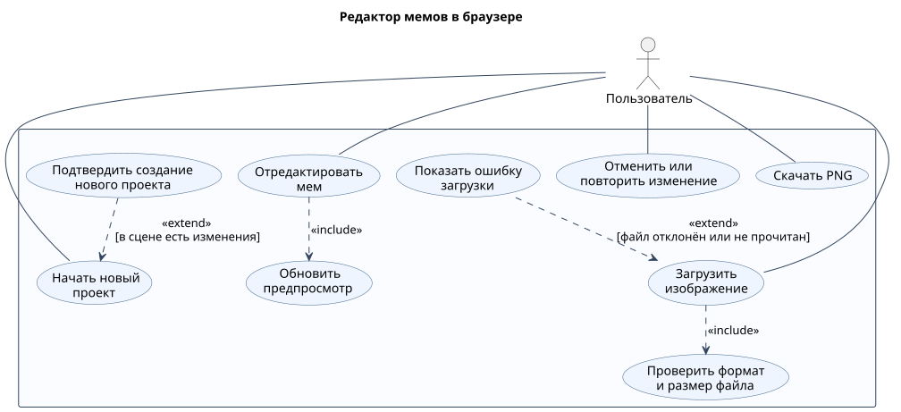

# Лабораторная работа № 5. Моделирование поведения

Вариант 72 — простой графический редактор для создания мемов. Пользователь создаёт холст, выбирает локальное изображение, добавляет надписи, меняет их оформление и скачивает готовый мем. Редактор обрабатывает данные в браузере. Сцена и история правок хранятся в памяти до закрытия или перезагрузки страницы. Учебная SQLite-модель из лабораторной № 4 существует отдельно.

## Диаграмма вариантов использования



[PNG](../use_case/use_case_diagram.png) · [PlantUML](../use_case/use_case_diagram.puml)

Пользователь — единственный внешний актор. В сценарий загрузки входит проверка формата и размера (`include`). Показ ошибки расширяет загрузку при отклонении или сбое чтения (`extend`). Новый проект начинается с пустого холста 1200 × 1200. Если в сцене уже есть изображение, надписи или изменённый фон, редактор запрашивает подтверждение сброса (`extend`).

Редактирование включает добавление, выбор, оформление, перемещение и удаление надписей, управление порядком слоёв и изменение фона. После принятой правки редактор перерисовывает предпросмотр (`include`).

## Диаграммы последовательности

| Сценарий | Диаграмма | Требования |
| --- | --- | --- |
| SQ-01. Загрузка изображения | [PNG](sequence/load_image_sequence.png) · [SVG](sequence/load_image_sequence.svg) · [PlantUML](sequence/load_image_sequence.puml) | FR-01, FR-02, REL-01, REL-02 |
| SQ-02. Добавление и редактирование надписи | [PNG](sequence/edit_text_sequence.png) · [SVG](sequence/edit_text_sequence.svg) · [PlantUML](sequence/edit_text_sequence.puml) | FR-03, FR-05, FR-07, FR-08 |
| SQ-03. Отмена и повтор изменений | [PNG](sequence/history_sequence.png) · [SVG](sequence/history_sequence.svg) · [PlantUML](sequence/history_sequence.puml) | FR-06, FR-08 |
| SQ-04. Экспорт мема в PNG | [PNG](sequence/export_png_sequence.png) · [SVG](sequence/export_png_sequence.svg) · [PlantUML](sequence/export_png_sequence.puml) | FR-09, FR-10, REL-01, REL-02 |

**SQ-01.** Редактор проверяет MIME-тип PNG, JPEG или WebP и размер до 10 000 000 байт. Браузер декодирует файл через локальный объектный URL. При успешном чтении в сцене сохраняется изображение, а холст получает его исходные размеры. Ошибка сохраняет прежнюю сцену. Счётчик загрузок защищает от позднего ответа для предыдущего файла.

**SQ-02.** Модель создаёт надпись с уникальным идентификатором, параметрами по умолчанию и выделяет её. Меняя текст, шрифт, размер, цвет, выравнивание или обводку, пользователь меняет выбранный блок. Принятая правка добавляет снимок сцены в историю и обновляет предпросмотр.

**SQ-03.** Отмена или повтор перемещает указатель по снимкам сцены. Редактор восстанавливает выбранный снимок и состояние кнопок. После новой правки сохранённые состояния правее текущего больше не доступны через повтор. По умолчанию история хранит до 100 состояний.

**SQ-04.** Редактор ждёт готовности шрифтов, если браузер поддерживает эту возможность, затем рисует сцену на отдельном холсте. Экспорт сохраняет размеры сцены, фон, изображение и порядок текста. Маркер выделения используется только в редакторе. При успехе браузер скачивает `meme.png`. Если PNG подготовить не удалось, редактор показывает ошибку и сохраняет сцену.

Реализация описана по [обработчикам редактора](../../script.js), [модели сцены](../../scene.js) и [техническому заданию](../../wiki/Техническое-задание.md).

## Повторный экспорт

Диаграммы созданы в PlantUML 1.2025.4. Для Use Case используется раскладка Smetana. Команды запускаются из корня репозитория.

```sh
java -jar /path/to/plantuml.jar -failfast2 -charset UTF-8 -tpng docs/use_case/use_case_diagram.puml docs/behavior/sequence/*_sequence.puml
java -jar /path/to/plantuml.jar -failfast2 -charset UTF-8 -tsvg docs/use_case/use_case_diagram.puml docs/behavior/sequence/*_sequence.puml
```
